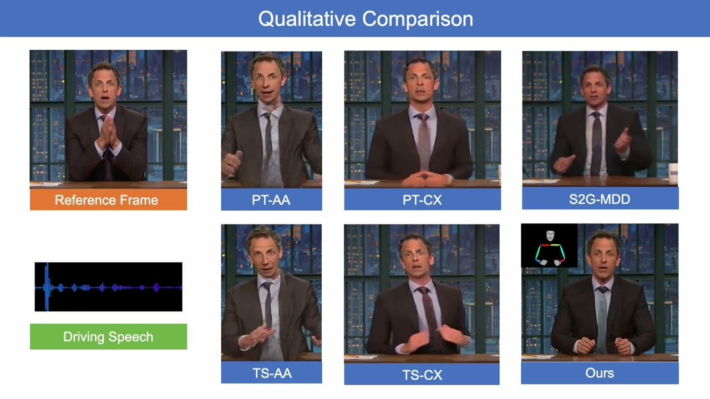
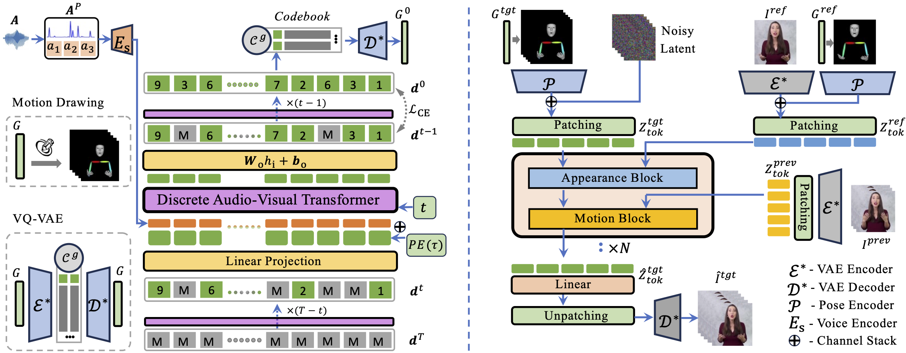

<h1 align="center">Cosh-DiT: Co-Speech Gesture Video Synthesis via Hybrid Audio-Visual Diffusion Transformers</h1>

<p align="center">
  <a href="https://scholar.google.com/citations?user=Vrq1yOEAAAAJ">Yasheng Sun</a><sup>1,3*</sup> ·
  <a href="https://seanseattle.github.io/">Zhiliang Xu</a><sup>2*</sup> ·
  <a href="https://hangz-nju-cuhk.github.io/">Hang Zhou</a><sup>2</sup> ·
  <a href="https://scholar.google.com/citations?user=LocNpywAAAAJ">Jiazhi Guan</a><sup>4</sup> ·
  Quanwei Yang<sup>5</sup> ·
  <a href="https://scholar.google.com/citations?user=2Pedf3EAAAAJ">Kaisiyuan Wang</a><sup>2</sup> ·
  <a href="https://scholar.google.com/citations?user=miLIl2gAAAAJ">Borong Liang</a><sup>2</sup> ·
  Yingying Li<sup>2</sup> ·
  <a href="https://scholar.google.com/citations?user=pnuQ5UsAAAAJ">Haocheng Feng</a><sup>2</sup> ·
  <a href="https://jingdongwang2017.github.io/">Jingdong Wang</a><sup>2</sup> ·
  <a href="https://liuziwei7.github.io/">Ziwei Liu</a><sup>6</sup> ·
  <a href="https://www.vogue.cs.titech.ac.jp/koike">Hideki Koike</a><sup>1</sup>
  <br>
  <sup>1</sup>KAUST · <sup>2</sup>Baidu Inc. · <sup>3</sup>Tokyo Institute of Technology · <sup>4</sup>Tsinghua University ·
  <sup>5</sup>USTC · <sup>6</sup>S-Lab, Nanyang Technological University
  <br>
  <sup>*</sup>Equal contribution
</p>

<p align="center">
  <a href="https://arxiv.org/abs/2503.09942"></a>
  <a href="https://sunyasheng.github.io/projects/COSH-DIT"></a>
  <a href="https://doi.org/10.1007/s11263-026-02752-z"></a>
  <a href="https://www.youtube.com/watch?v=suyoiSz2hoc"></a>
  <a href="https://huggingface.co/papers/2503.09942"></a>
</p>

<p align="center">
  <a href="https://www.youtube.com/watch?v=suyoiSz2hoc"></a>
  <br>
  <em>Click the image to watch the demo video on YouTube.</em>
</p>

## Abstract

Co-speech gesture video synthesis is a challenging task that requires both probabilistic modeling of human gestures and the synthesis of realistic images that align with the rhythmic nuances of speech. To address these challenges, we propose **Cosh-DiT**, a Co-speech gesture video system with hybrid Diffusion Transformers that perform audio-to-motion and motion-to-video synthesis using discrete and continuous diffusion modeling, respectively. First, we introduce an audio Diffusion Transformer (**Cosh-DiT-A**) to synthesize expressive gesture dynamics synchronized with speech rhythms. To capture upper body, facial, and hand movement priors, we employ vector-quantized variational autoencoders (VQ-VAEs) to jointly learn their dependencies within a discrete latent space. Then, for realistic video synthesis conditioned on the generated speech-driven motion, we design a visual Diffusion Transformer (**Cosh-DiT-V**) that effectively integrates spatial and temporal contexts. Extensive experiments demonstrate that our framework consistently generates lifelike videos with expressive facial expressions and natural, smooth gestures that align seamlessly with speech.

## Method

<p align="center">
  
</p>

**Left:** Cosh-DiT-A, a discrete audio-visual Diffusion Transformer, predicts gesture tokens from speech. VQ-VAEs learn the codebook that jointly encodes upper body, face and hand motion. **Right:** Cosh-DiT-V, a visual Diffusion Transformer with appearance and motion blocks, renders video frames from the generated motion, a reference image and the previous frames.

## Code

The code release is in preparation and will be published in this repository.

## Citation

If you find Cosh-DiT useful, please cite:

```bibtex
@article{sun2026coshdit,
  title   = {Cosh-DiT: Co-Speech Gesture Video Synthesis via Hybrid Audio-Visual Diffusion Transformers},
  author  = {Sun, Yasheng and Xu, Zhiliang and Zhou, Hang and Guan, Jiazhi and Yang, Quanwei
             and Wang, Kaisiyuan and Liang, Borong and Li, Yingying and Feng, Haocheng
             and Wang, Jingdong and Liu, Ziwei and Koike, Hideki},
  journal = {International Journal of Computer Vision},
  volume  = {134},
  number  = {3},
  pages   = {85},
  year    = {2026},
  doi     = {10.1007/s11263-026-02752-z}
}
```
